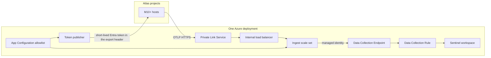

# Architecture

Version 0.9 is a push connector. Atlas OpenTelemetry log export sends `mongod`, `mongos`, audit, and event logs to an HTTPS OTLP endpoint. The connector does not poll the Atlas Admin API for log lines and it is not bound to one `group_id`.

## Ingest

The scale set runs at least two instances behind an internal load balancer. Port 443 on the balancer reaches TLS port 8443 on a replica. A separate health listener on port 8080 answers `/healthz` and `/readyz` and does not accept logs. Replicas scale out on CPU, up to 20.

Each replica validates the bearer token, resolves the Atlas project, and uploads the batch to the Logs Ingestion API with its own managed identity. Upload is synchronous, so a failed batch is retried by Atlas. `RecordHash` lets a workbook or analytic rule drop duplicates. There is no workspace shared key.

Unknown projects, unknown Entra clients, and sink hosts outside `*.ingest.monitor.azure.com`, `*.ingest.monitor.azure.us`, and `*.ingest.monitor.azure.cn` are rejected. An empty client allowlist is rejected. `ALLOW_INSECURE_DEV` is refused when the process is running with a managed identity.

## Multi-project allowlist

App Configuration holds one JSON object per project at `atlas-sentinel/project/{groupId}`. The deployment script seeds that store from `projectsConfigJson`. A file can replace the store for local tests. Projects may name their own Data Collection Endpoint, rule, stream, and table. Otherwise they use the deployment default, `Custom-MongoDBAtlasLogs_CL` and `MongoDBAtlasLogs_CL`.

One deployment can serve many Atlas projects and more than one Entra tenant on the ingest path. The token publisher in this version uses one Entra tenant. Projects in another tenant are skipped by the publisher and still rejected or accepted by ingest according to the allowlist.

## Token publisher

Atlas log export accepts headers, not an OAuth client-credentials handshake. The publisher is the bridge until Atlas can request an Entra token itself. It signs a client assertion with a certificate held in Key Vault, asks Entra for a short-lived access token, validates that token with the same rules as ingest, and writes only that token into the Atlas log integration. The publisher updates an existing `logIntegrationId`. `-bootstrap` creates a missing integration and prints the group id and integration id, never the token.

The Atlas service-account secret is used only for the Admin API call that installs the header. It is read from Key Vault. It is not the credential Atlas presents to the OTLP endpoint.

## Private path

The OTLP listener has no public IP. Clients reach it through the Private Link Service in front of the internal balancer. The Logs Ingestion hop uses an Azure Monitor Private Link Scope with ingestion set to PrivateOnly, a private endpoint, and the private DNS zones that endpoint requires. A NAT gateway public IP is egress only, for Entra metadata, the Atlas Admin API, and a container registry.

## Identities

The ingest identity can publish to the Data Collection Rule, read the TLS certificate secret, and read App Configuration. The publisher identity can read the control vault, sign with the Entra certificate, and read App Configuration. The two vaults are separate so the ingest process cannot read the Atlas secret or the signing key. The seed identity can write App Configuration and is not attached to a virtual machine.
