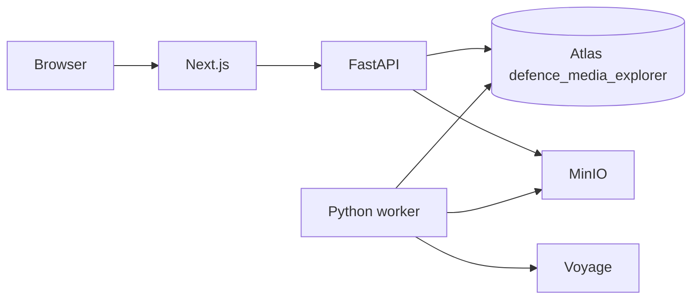

# Architecture

Defence Media Explorer is a Next.js interface and a FastAPI service. Media bytes live in object storage. Searchable JSON, transcripts, and embeddings live in MongoDB Atlas, in the database `defence_media_explorer` on the cluster referred to here as federazionecup. Ingestion jobs live in the `ingestion_jobs` collection in that same database. There is no Redis process and no MongoDB container in Compose.



The browser never receives a MongoDB host or a connection string. Health reports capability names, models, dimensions, index status, and whether an index is queryable.

## Processes

| Process | Role |
| --- | --- |
| `frontend` | Pages, locale, time zone, theme. Rewrites `/api` to `API_INTERNAL_URL`. |
| `api` | Auth, uploads, search, metadata. Ensures indexes in `defence_media_explorer` on startup. It writes a job document. It does not run FFmpeg, transcription, or embedding. |
| `worker` | Claims `ingestion_jobs`, then validates, extracts, embeds, and writes `segments`. One generation is written, then the previous generation is removed. |
| `minio` | S3-compatible bytes. `S3_ENDPOINT` is what the API and worker use. `S3_PUBLIC_ENDPOINT` is what signed browser URLs use. |

The API, the worker, and MinIO are separate processes. Atlas is remote. If the worker runs on a laptop, ingestion waits for that laptop. If MinIO runs on a laptop, media access waits for that laptop. The worker command is the same on a laptop and on an always-on host:

```bash
cd backend
python -m app.workers
```

More than one worker process can run that command. A job is claimed with `findOneAndUpdate`, so a second process does not take a lease that is still valid.

## Search

An empty query browses segments with a complete count. A non-empty query uses semantic, full-text, or hybrid mode.

Hybrid search calls `$rankFusion` on MongoDB 8 when that stage is accepted. If the deployment rejects it, the API fuses the two ranked lists with reciprocal rank fusion. Scores from the two engines are not added together.

Semantic search needs Voyage. Full-text search uses Atlas Search. The text index uses `lucene.standard` plus five language multi-fields. Full-text does not translate the query or the archive.

The API returns `retrievedCandidateCount` for a ranked window and `completeMatchCount` for a browse. The interface shows elapsed time only when the API returns `elapsedMs`. It does not show a similarity percentage.

## Ingestion

Files of 64 MB or smaller are posted to the API. Larger files are split into presigned parts. The browser sends `X-DME-Request: 1` to the API and does not send that header to MinIO.

The worker keeps the original object, writes derivatives, and stores one segment document per window. Embeddings are fields on `segments`. If Voyage or OpenAI is not configured, the segment is saved as partial and the missing capability is named. The pipeline does not invent vectors.

`indexingState: persisted` means the document was written. It does not mean the Atlas Search or Vector Search index is queryable yet. Health reads index status separately.

## Interface

Locales are `it-IT`, `en-GB` (default), `fr-FR`, `es-ES`, and `de-DE`. Messages are imported statically. The language control is only on Settings, using native names. Locale and time zone are stored in `localStorage` and in the cookies `dme_locale`, `dme_tz`, and `dme_theme`. After sign-in, the profile locale and time zone replace the browser values.

Search and filter state is in the URL. The upload draft is a module store, so a language change or a client navigation does not clear it.

Timestamps are stored in UTC and shown in the selected time zone. That zone is independent of the interface language, and date filters name the zone they use.
